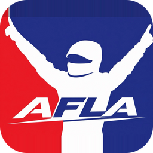

<p align="center">
  
</p>

<h1 align="center">ALFA Racing</h1>

<p align="center">심레이싱 프로그램을 버튼 하나로 켜고 끄는 Windows 런처</p>

---

## 다운로드

[**Releases**](../../releases/latest) 에서 `ALFARacing.exe` 를 받아서 실행하면 돼요. 설치나 .NET 설치는 필요 없어요.

> 처음 실행할 때 **"Windows의 PC 보호"** 창이 뜨면 **추가 정보 → 실행** 을 눌러 주세요. (서명되지 않은 exe라서 뜨는 경고예요.)

## 사용법

| 버튼 | 하는 일 |
|---|---|
| **▶ 시작** | 시작 목록의 프로그램을 위에서부터 순서대로 켜요. 이미 켜져 있는 건 건너뛰어요. |
| **■ 종료** | 시작 목록에서 "종료 시 끄기"가 체크된 프로그램을 **켠 순서의 반대로** 꺼요. 먼저 창을 닫아 정상 종료를 요청하고, 안 꺼지면 강제로 종료해요. |

- **처음 실행**하면 설치된 프로그램을 자동으로 찾아서 시작 목록을 만들어 줘요.
- **설정 → 시작 목록**: 프로그램 추가(파일 선택 / 실행 중인 프로그램에서 고르기), 편집, 순서 변경, 사용 여부, 종료 시 끄기.
- **설정 → 종료**: 정상 종료 대기 시간, iRacing 주행 중 확인, 시작 목록에 없는 프로그램 추가로 끄기.
- **설정 → 추천 프로그램**: 설치 여부 확인, 다운로드 페이지, 시작 목록에 바로 추가.
- **Trading Paints가 없으면** 메인 화면에 경고가 떠요.

### 기본 시작 순서

| 순서 | 프로그램 | 분류 | 비고 |
|---|---|---|---|
| 1 | [MOZA Pit House](https://mozaracing.com/pages/pit-house) | 장비 | 휠베이스가 먼저 잡히도록 가장 먼저 |
| 2 | [Trading Paints](https://www.tradingpaints.com/install) | **필수** | 다른 드라이버들의 페인트 |
| 3 | [CrewChief](https://thecrewchief.org/) | 추천 | 음성 스포터 / 크루 치프 |
| 4 | [irDashies](https://irdashies.com/) | 추천 | 오픈소스 iRacing 오버레이 |
| 5 | [Bloops](https://bloo.ps/) | 추천 | Garage 61 레퍼런스 랩 기반 브레이킹 오디오 큐 |
| 6 | [iRacing](https://www.iracing.com/) | 게임 | 마지막에 실행 (Steam판은 `steam://rungameid/266410`) |

## 자주 묻는 것

- **어떤 프로그램이 안 꺼져요 ("관리자 권한으로 실행 중")**: 그 프로그램이 관리자 권한으로 돌고 있어서 그래요. ALFA Racing을 마우스 오른쪽 버튼 → **관리자 권한으로 실행** 으로 켜면 끌 수 있어요.
- **실행 중인데 "꺼짐"으로 보여요**: 프로세스 이름이 다를 수 있어요. 설정 → 시작 목록 → 편집에서 작업 관리자 **세부 정보** 탭에 보이는 이름(.exe 없이)을 넣어 주세요. `iRacingSim*` 처럼 끝에 `*`를 붙이면 앞부분만 같아도 돼요.
- **설정 파일 / 로그**: `%APPDATA%\ALFA Racing\settings.json`, `%APPDATA%\ALFA Racing\logs\alfa-racing.log` (설정 → 일반에서 폴더 열기)
- **Windows 필수 프로세스**(explorer, svchost 등)는 실수로 넣어도 절대 끄지 않아요.

## 개발

- C# / .NET 10 / WPF (Fluent 다크 테마)
- `src/AlfaRacing.Core` — 실행·종료 로직, 설치 감지, 설정 (플랫폼 독립, 테스트 가능)
- `src/AlfaRacing.App` — WPF 화면
- `tests/AlfaRacing.Core.Tests` — xUnit 테스트

```bash
dotnet test tests/AlfaRacing.Core.Tests
```

```bash
dotnet publish src/AlfaRacing.App -c Release -r win-x64 -o publish
```

Windows가 아니어도(macOS/Linux) 위 명령으로 Windows용 exe를 만들 수 있어요.

`main` 에 push 하면 GitHub Actions(Windows)가 테스트 → exe 빌드 → 모든 화면을 띄워 보는 스모크 테스트 → Releases 업데이트까지 해요. 화면 스크린샷은 `ci-preview` 브랜치에 올라가요.
